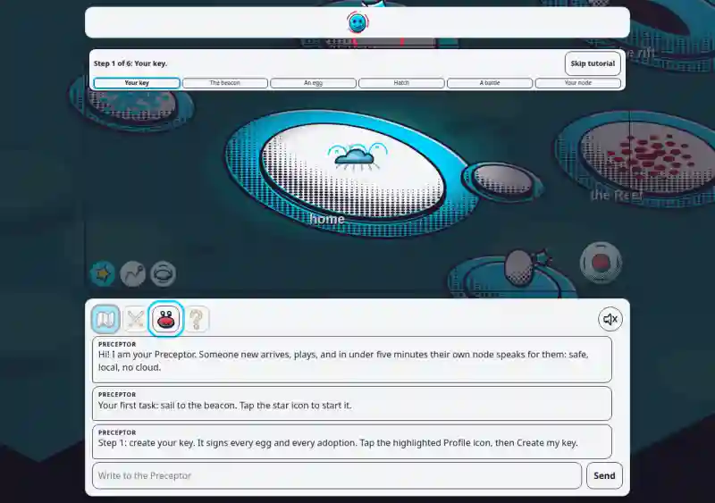
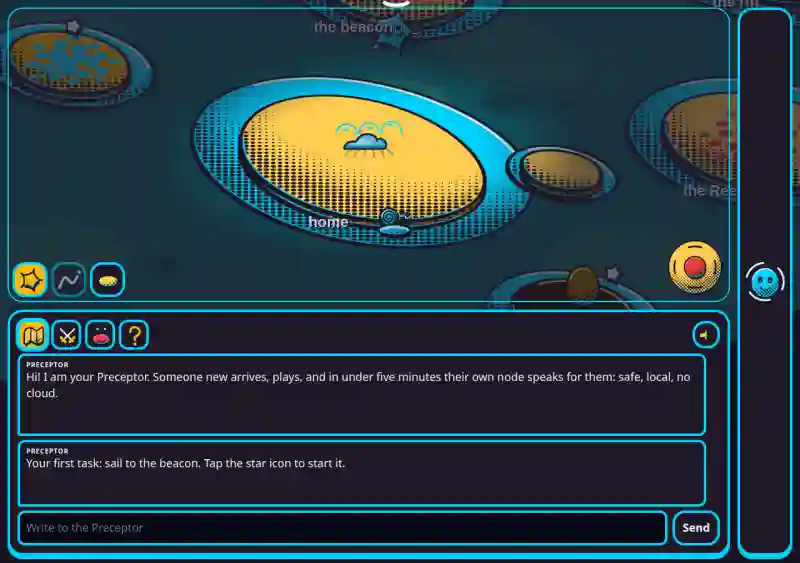
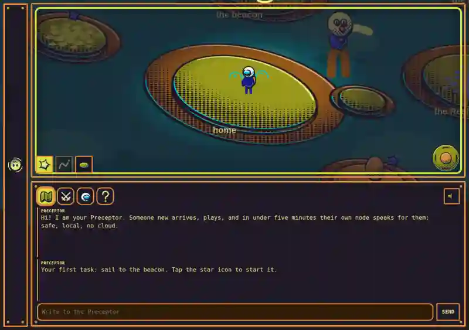

# Colony app: visual audit and replacement plan

2026-10-28. Law: [commission and verification decree](https://github.com/piskyRpapalo/preceptoros-web/pull/387#issuecomment-6469997513). This is an audit and plan, not a completed replacement.

## Measured before

On the rack: app tree at `26d662eb151538c0b00b5d87b43b5de1e5e44c0a`, served locally by `PRECEPTOROS_PWA_PUERTO=18884 python3 bin/preceptoros-pwa`; Google Chrome headless, 1280x900, 5000 ms virtual-time budget, `/face/basic.html`. The second screenshot uses the same settings at `/face/atlantis.html`. Both displayed images are resized, lossy WebP copies (800 pixels wide, 15,308 and 15,592 bytes); it is a local app capture, not a live web or device capture. The image shows the old rounded island terrain, home, Reef and tutorial. `interface/face/face_world.js` defines nine blob islands, three tutorial places and two fixed node-like waves. These are not the state-driven hex colony, and fixed marks do not establish node liveness. The same world module is loaded by all three app face pages.

After screenshot: NO_DATA, cause: the replacement has not been implemented or captured. The image above is not an after image. Device and live deployment verification: NO_DATA, cause: this capture is from a local browser against this tree.

## History and distinction

- App commit `7327ace9b59d9971193f3da3386ad4bb1889b469` (2026-10-24) added `face_world.js` and three face layouts; the commit describes a web twin.
- App commit `bdf4ff2e6713aa7493d7d4e238cbd4d80dfc09` (2026-10-24) introduced the fixed isometric plane and painter components. An isometric plane is not itself the new hex colony.
- App commit `96769a9bdb977ccee45d04db4c3f5835bef38b48` (2026-10-24) added seabed and crab graphics. The present island map retains this older visual model.
- Web history: `e4dd827` introduced the OpenWorld cabin and zero nodes; `2891103` added the global map in that door, and `fe51495` changed its lexicon identifiers. The Sovereign's live screenshots in the decree report a separate older circular Hexelion-centered Worlds map and the older cabin graphic at the OpenWorld door. Their persistence on a particular client cannot be attributed to cache or routing without measurement.
- The new model is the feature-law hex lattice, fixed projection and node rows, with only live nodes shown. The app's `colony/core.js` and `colony/projection.js` are proposed computational foundations; they are not wired to the app face and their synthetic raster is not evidence of shared browser pixels.

## Replacement plan

1. Coordinate the canonical web state schema, renderer, projection, asset versions and fixture with the web owner through the commission thread. Import the same reviewed implementation into the app, align static routes, service worker and version, and route all app map doors and tutorial navigation to the same map; remove the old island and circular views from those entry points. Preserve tutorial interaction on the shared map, not a second view.
2. Use a measured poll result for each node: LIVE only on a successful current observation; on failure or expiry mark STALE with its cause and remove that node from the visible map. Do not convert missing endpoints or unmeasured mana into values. Poll transport, identity and freshness policy are NO_DATA until their authoritative contract is found; no guessed endpoints.
3. With the same input frame, viewport, runtime and rendering conditions, capture web and app twice and compare bitmap bytes and hashes; include a state-change sabotage and a changed-bitmap sabotage. Capture before and after at the actual entry points and verify refresh and offline cache behavior. First motion measurement is on the weakest live fleet device. Human visual fidelity remains NO_DATA until measured by the rack sessions.

## Log

- 2026-10-28: old app graphics observed in a local browser; after, shared renderer, live-node source and cross-surface byte parity are NO_DATA for the causes above. No poll or rendered replacement has been claimed.

## Reference and preservation

The reference was cloned on 2026-10-28 at commit `8cd9d76b3bf5eddaec7d4ba88f0d1c0547a312dc`. Its visual-check documentation describes 42 synthetic threads and seeded movement; its render-check documents frozen-frame and camera-motion checks. These are reference descriptions, not measurements by this audit. Cite the reference without copying its assets or code.

This local screenshot uses the same browser settings at `/face/zombie.html`, compressed to an 800-pixel WebP (12,270 bytes). It shows the friendly wanderer, space-soldier avatar and terminal styling on the old island world. The Atlantis capture above shows its palette and layout; its initial viewport does not show the entire cast.

Catalog handoff: `interface/face/face_world.js` defines an octopus, starfish and snail, proximity reactions and phrases for Atlantis; the Risen has a friendly wanderer, move-driven patrol and proximity phrase. `interface/face/skins.json` and page skin data define clothing and soldier accessories; Atlantis has its own palette and zones layout. These are source findings, not verified shared catalog entries. Preserve them in the shared catalog; web/app byte parity remains NO_DATA until measured.

The existing world module combines geometry and skin-driven paint. The new map state and projection stay pure; a separate layer consumes that same state for terminal colors and transitions and respects reduced motion. It does not decide node existence. Poll sources and freshness policy remain NO_DATA until established. The node-only first landing still precedes the separately gated buildings.
