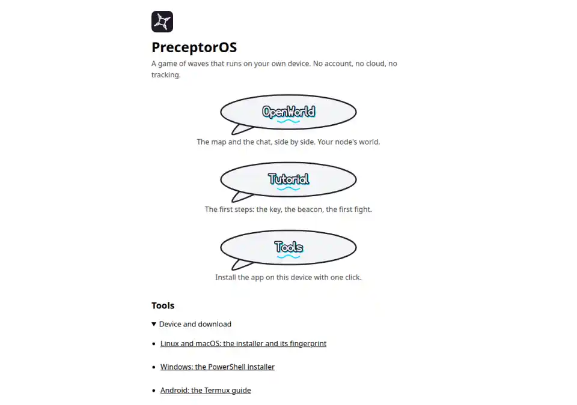

# Start-screen honesty: measured before state

Commission: [app #134 discussion](https://github.com/piskyRpapalo/PreceptorOS/pull/134). The reported start surface is the public web root, not the app launcher's `/` face. Web source inspected at `2270db32d1f46b18ed54fc8c1ab6389f022f78e3`; app main at `16f6eb33b0a6bf209be58685d36fba1b8044f888`. This is a before-state audit, not the requested repair.

2026-10-28: headless Chrome, 1280×900, `https://preceptoros.org/`, 4,000 ms virtual-time budget; original PNG SHA-256 `c86198e4800ed6691e65d7bab8c2c646697d8a74860d408caf1759ff77ebb092`. This committed image is a resized lossy copy. It shows OpenWorld, Tutorial and Tools doors and the Tools list below. It is a live web capture, not a physical tap or after-state receipt.

Search performed on the pinned web root document and its referenced start control module: `rg -n -i 'tutorial|tools|openworld' public/index.html public/assets/intro.js`. Tutorial occurrence on this start surface: [public/index.html:38](https://github.com/piskyRpapalo/preceptoros-web/blob/2270db32d1f46b18ed54fc8c1ab6389f022f78e3/public/index.html#L38), the Tutorial label and `/play/` door in one line. The search found no Tutorial occurrence in `public/assets/intro.js`. This is not a claim about other routes, generated text, locales or a later revision.

The OpenWorld door is [index.html:37](https://github.com/piskyRpapalo/preceptoros-web/blob/2270db32d1f46b18ed54fc8c1ab6389f022f78e3/public/index.html#L37); the Tools button is [line 39](https://github.com/piskyRpapalo/preceptoros-web/blob/2270db32d1f46b18ed54fc8c1ab6389f022f78e3/public/index.html#L39); the below-list is [lines 41–52](https://github.com/piskyRpapalo/preceptoros-web/blob/2270db32d1f46b18ed54fc8c1ab6389f022f78e3/public/index.html#L41). Its four existing entries are Linux and macOS installer/fingerprint, Windows PowerShell installer, Android Termux guide, and Creation studio. The first three link to `/get-the-app/`; the last links to `/creation.html`. The control module [intro.js:25](https://github.com/piskyRpapalo/preceptoros-web/blob/2270db32d1f46b18ed54fc8c1ab6389f022f78e3/public/assets/intro.js#L25) currently attempts the PWA install when offered, otherwise scrolls to the existing list; it does not open a separate Tools panel.

After capture, two-door and tool-parity tests, and a launcher receipt for the repaired surface: NO_DATA, cause: no repair or production route was implemented by this audit. Physical tap: NO_DATA, cause: headless capture only. The app's prior [launcher receipt](https://github.com/piskyRpapalo/PreceptorOS/blob/16f6eb33b0a6bf209be58685d36fba1b8044f888/docs/evidence/launcher-receipt.json) concerns the separate app face and cannot prove the web start repair.
